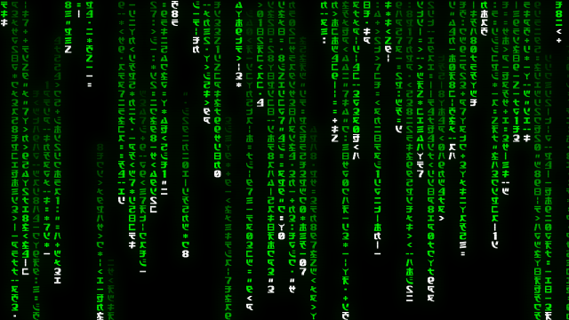

# Matrix Digital Rain Screensaver

[](https://github.com/rwz/matrix-macos-screensaver/actions/workflows/build.yml?query=branch%3Amain)
[](https://opensource.org/licenses/MIT)
[](https://www.apple.com/macos/)
[](https://swift.org)
[](https://buymeacoffee.com/cassmtnr)

A Matrix-style screensaver for macOS with real-time falling green characters.

Fork of [cassmtnr/matrix-macos-screensaver](https://github.com/cassmtnr/matrix-macos-screensaver) that drops the intro sequence and goes straight into the rain, with a smaller font and longer trails.

<p align="center">
  
</p>

## Features

- **Authentic digital rain** — Matrix-Code font with 57 custom glyphs, glowing white heads and fading green trails
- **Frame-rate independent** — delta-time animation. Consistent speed at any FPS
- **Multi-display & adaptive** — scales to any screen resolution across all connected displays

## Installation

### Download

1. Download the latest build: [`MatrixDigitalRain.saver.zip`](https://github.com/rwz/matrix-macos-screensaver/releases/download/latest/MatrixDigitalRain.saver.zip) (rebuilt on every push to `main`)
2. Unzip it. The build is ad-hoc signed, not notarized, so clear the download quarantine flag:
   ```bash
   xattr -dr com.apple.quarantine MatrixDigitalRain.saver
   ```
3. Double-click `MatrixDigitalRain.saver` to install
4. Select it in **System Settings > Screen Saver**

### Build from Source

```bash
git clone https://github.com/rwz/matrix-macos-screensaver.git
cd matrix-macos-screensaver

xcodebuild -project MatrixDigitalRain.xcodeproj \
  -scheme MatrixDigitalRain \
  -configuration Release \
  -derivedDataPath build \
  CODE_SIGN_IDENTITY=- CODE_SIGN_STYLE=Manual DEVELOPMENT_TEAM= \
  build

open build/Build/Products/Release/MatrixDigitalRain.saver
```

The `CODE_SIGN_*` overrides sign the bundle ad-hoc, so no Apple developer account is needed. Requires macOS 12.0+.

## Development

```bash
# Build
xcodebuild -project MatrixDigitalRain.xcodeproj \
  -scheme MatrixDigitalRain -configuration Release \
  -derivedDataPath build \
  CODE_SIGN_IDENTITY=- CODE_SIGN_STYLE=Manual DEVELOPMENT_TEAM= \
  build

# Preview (Esc, Cmd+Q or click to quit)
swift preview.swift
swift preview.swift --duration 30

# Tests
xcodebuild -project MatrixDigitalRain.xcodeproj \
  -scheme MatrixDigitalRain -configuration Debug \
  CODE_SIGN_IDENTITY=- test

# Generate preview GIF (requires ffmpeg)
swift generate_preview.swift --help

# ...or without installing ffmpeg, via Docker (frames must live under the repo)
PATH="$PWD/scripts/ffmpeg-docker:$PATH" swift generate_preview.swift \
  --skip 4 --render-width 1280 --render-height 720 --temp-dir build/preview-tmp
```

### Builds

Every push to `main` runs [`.github/workflows/build.yml`](.github/workflows/build.yml): it runs the tests, builds an ad-hoc signed Release bundle, and publishes it to the [`latest`](https://github.com/rwz/matrix-macos-screensaver/releases/tag/latest) pre-release.

Signed and notarized releases need a Developer ID certificate; see [`RELEASING.md`](RELEASING.md).

### Project Structure

```
MatrixDigitalRain/
├── MatrixConfig.swift           # All tunable constants
├── MatrixColumn.swift           # Single falling column logic
├── MatrixDigitalRainView.swift  # Main ScreenSaverView subclass
├── Matrix-Code.ttf              # Custom font (57 glyphs)
└── Info.plist
```

## License

MIT
